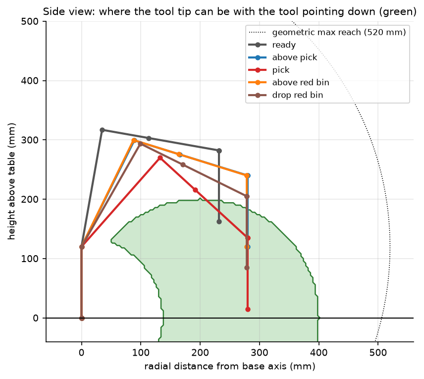
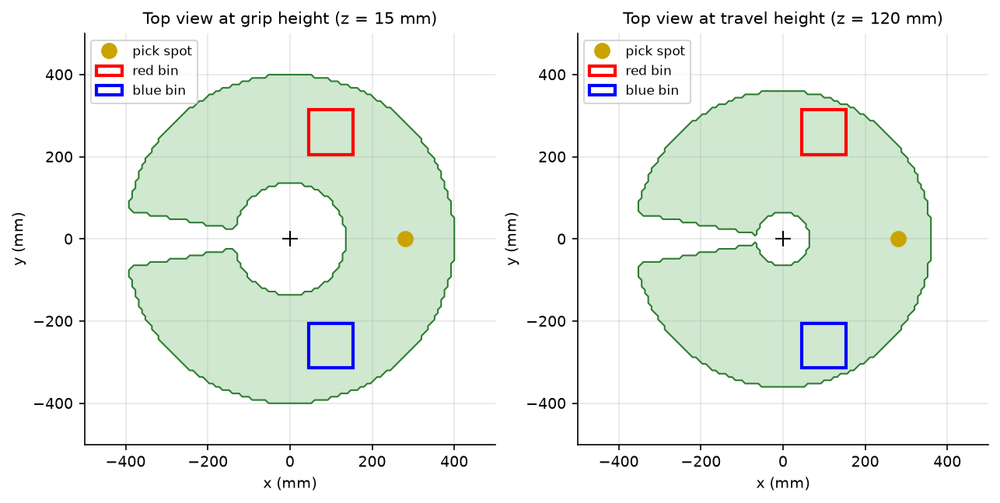
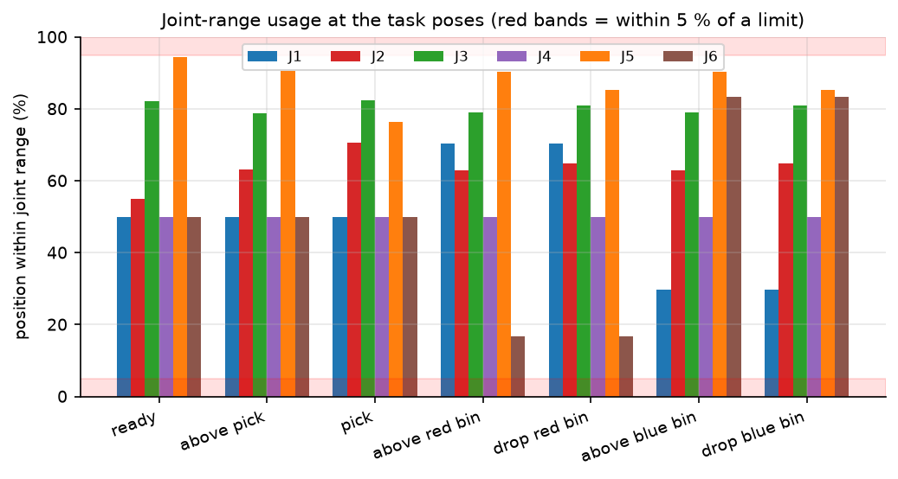

# E1 - Kinematics and workspace

**Script:** `experiments/e1_kinematics_workspace.py` · **Model:** `arm/kinematics.py`, `arm/params.py`

> **Status of the inputs.** Link lengths, part masses and the cell layout are placeholders from `arm/params.py`, set before the CAD existed. Motor data other than the spec-book figures are typical catalogue values. The method and the scripts are final; the numbers must be regenerated (`uv run python -m experiments.run_all`) once the CAD values are entered.

## Purpose

Show that the proposed arm geometry can do the minimum demonstration (pick at the fixed
location, place in two bins) and that the inverse kinematics the firmware host will use is
correct. This supports the choice of link lengths and of the cell layout.

## Model

Six revolute joints: base yaw, shoulder pitch, elbow pitch, forearm roll, wrist pitch, tool
roll. The last three axes meet at one point (spherical wrist), so the inverse kinematics has a
closed form: the wrist centre fixes J1-J3, the remaining rotation fixes J4-J6.

| Parameter | Value (mm) |
|---|---|
| Table to shoulder axis | 120 |
| Upper arm (shoulder to elbow) | 200 |
| Forearm (elbow to wrist centre) | 200 |
| Wrist centre to tool tip | 120 |
| Maximum reach from shoulder | 520 |

| Joint | Range (deg) | Actuator |
|---|---|---|
| J1 base yaw | -170 to 170 | 17HS4401 + printed 5:1 gear stage |
| J2 shoulder | -100 to 100 | 17HS4401S + PG518 5.18:1 + GT2 16:64 |
| J3 elbow | -140 to 140 | 17HS4401 + GT2 16:96 |
| J4 forearm roll | -90 to 90 | DS3218MG direct |
| J5 wrist pitch | -90 to 90 | DS3218MG direct |
| J6 tool roll | -90 to 90 | MG996 direct |

## Result 1 - the inverse kinematics is correct

2000 random joint configurations inside the limits were converted to a tool pose and solved back.

| Check | Result |
|---|---|
| Original configuration recovered | 2000 / 2000 |
| Worst pose error over every returned solution | 1.9e-12 (m or rad) |
| Solutions inside the joint limits per pose | 1.4 on average, up to 2 |

Verdict: PASS

## Result 2 - the task poses are reachable with margin

The green area is every tool-tip position the arm can hold with the tool pointing straight
down and all joints inside their limits. The coloured skeletons are the task poses.

| Pose | J1 / J2 / J3 / J4 / J5 / J6 (deg) | Smallest joint-limit margin (deg) | Distance to workspace edge (mm) | Jacobian condition number | Tool tilt from vertical (deg) | Verdict |
|---|---|---|---|---|---|---|
| ready | 0.0 / 10.0 / 90.0 / 0.0 / 80.0 / 0.0 | 10 (J5) | 35 | 1.7 | 0.00 | PASS |
| above pick | 0.0 / 26.4 / 80.8 / 0.0 / 72.8 / 0.0 | 17 (J5) | 57 | 2.0 | 0.00 | PASS |
| pick | 0.0 / 41.4 / 91.0 / 0.0 / 47.6 / 0.0 | 42 (J5) | 119 | 2.4 | 0.00 | PASS |
| above red bin | 69.0 / 26.0 / 81.4 / 0.0 / 72.6 / -60.0 | 17 (J5) | 58 | 2.0 | 0.00 | PASS |
| drop red bin | 69.0 / 29.8 / 86.5 / 0.0 / 63.7 / -60.0 | 26 (J5) | 85 | 2.1 | 0.00 | PASS |
| above blue bin | -69.0 / 26.0 / 81.4 / 0.0 / 72.6 / 60.0 | 17 (J5) | 58 | 2.0 | 0.00 | PASS |
| drop blue bin | -69.0 / 29.8 / 86.5 / 0.0 / 63.7 / 60.0 | 26 (J5) | 85 | 2.1 | 0.00 | PASS |

Pass rule: at least 5 deg from every joint limit and at least 20 mm inside the workspace edge.
The condition number stays low, so no task pose is near a singularity.

Overall verdict: PASS

## Result 3 - positioning resolution at the pick pose

Tool-tip displacement caused by the smallest commanded step of each joint, at the pick pose.

| Joint | Angular resolution | Lever arm to tool tip (mm) | Tool-tip step, commanded (mm) | Tool-tip step, full-step / repeatability (mm) |
|---|---|---|---|---|
| J1 base yaw | full step 0.360 deg, 1/8 microstep 0.0450 deg | 280 | 0.22 | 1.76 |
| J2 shoulder | full step 0.087 deg, 1/8 microstep 0.0109 deg | 299 | 0.06 | 0.45 |
| J3 elbow | full step 0.300 deg, 1/8 microstep 0.0375 deg | 295 | 0.19 | 1.54 |
| J4 forearm roll | PCA9685 12-bit count 0.44 deg, servo repeatability ~1 deg (ASSUMED) | 89 | 0.68 | 1.55 |
| J5 wrist pitch | PCA9685 12-bit count 0.44 deg, servo repeatability ~1 deg (ASSUMED) | 120 | 0.92 | 2.09 |
| J6 tool roll | PCA9685 12-bit count 0.44 deg, servo repeatability ~1 deg (ASSUMED) | 0 | 0.00 | 0.00 |

* Sum of commanded steps: **2.07 mm**. Sum of full-step and servo repeatability figures: **7.4 mm**.
* Gearbox backlash of 1 deg (assumed) becomes 0.25 deg at the shoulder after the belt stage,
  which is 1.3 mm at the tool tip. Gravity keeps the shoulder loaded on one side of the backlash for
  the whole cycle, so this mainly matters if the arm passes over vertical.
* The gripper opening must therefore tolerate a few millimetres of error. The right-hand column is pessimistic for the
  steppers (it assumes microstepping gives no accuracy gain), so in practice the wrist servos are the larger contributor.

## What this decides

* Link lengths of 200 / 200 / 120 mm cover the layout (pick at
  280 mm, bins at 279 mm from the base axis).
* The firmware host can use the closed-form inverse kinematics; no numerical solver is needed.
* Gripper jaws should open at least 45 mm for a 30 mm object.

## Limits of this experiment

* Reach is checked with the tool pointing down only, which is what the task needs.
* Self-collision and link thickness are not considered here; clearance to the bins and the table is checked in E4.

---
*Generated 2026-11-12 by the script named in the header.*
