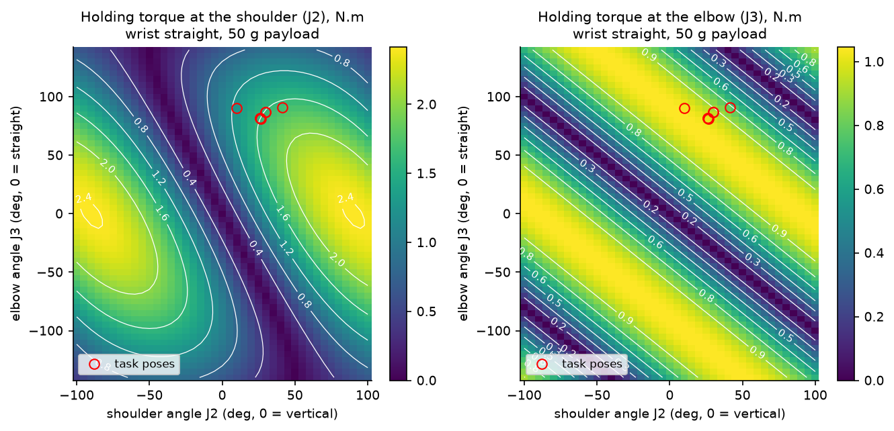
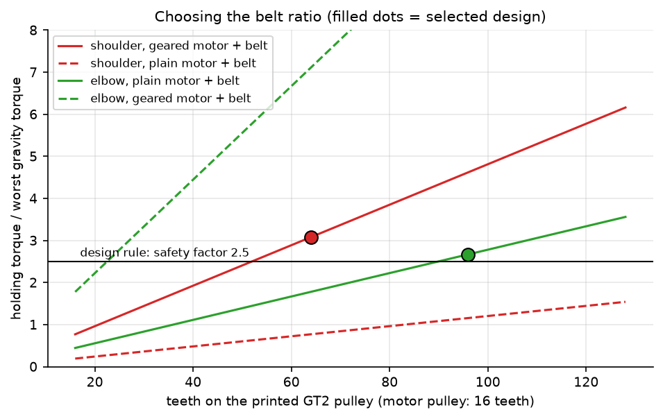
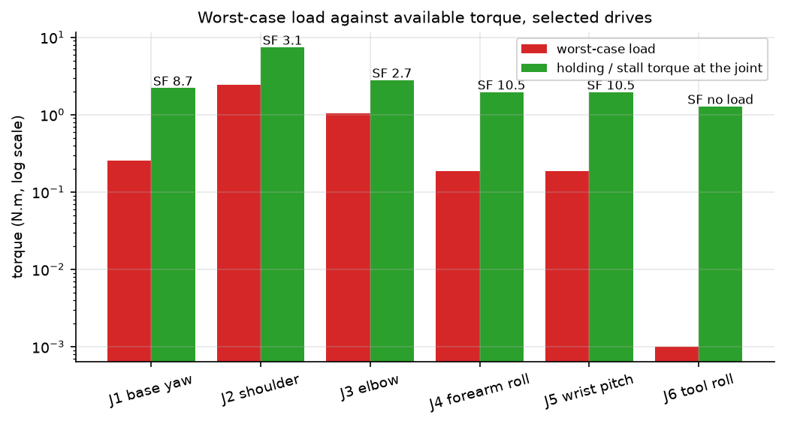
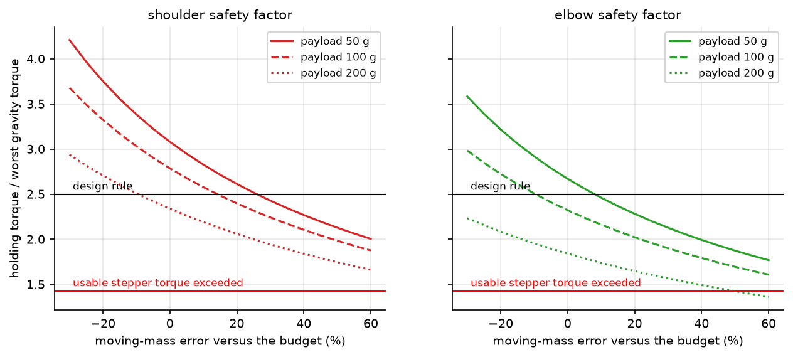

# E2 - Torque, load and reduction ratios

**Script:** `experiments/e2_torque_gearing.py` · **Model:** `arm/dynamics.py`, `arm/params.py`

> **Status of the inputs.** Link lengths, part masses and the cell layout are placeholders from `arm/params.py`, set before the CAD existed. Motor data other than the spec-book figures are typical catalogue values. The method and the scripts are final; the numbers must be regenerated (`uv run python -m experiments.run_all`) once the CAD values are entered.

## Purpose

Decide how the three steppers are geared. The kit has one stepper with a 5.18:1 planetary
gearbox, two plain steppers (0.49 N.m), 2 m of GT2 belt and two 16-tooth pulleys. This
experiment finds the worst load on every joint and picks the reductions that hold it with margin.

## Method

* Every part is a point mass on its link (table below). The holding torque at joint *j* is
  the sum of `m g (axis_j x (r_mass - r_joint)) . z` over all masses the joint carries.
* The same masses are built into the MuJoCo model, and the two agree to better than
  1e-6 N.m on random poses (checked in `experiments/run_all.py`).
* Worst case: the whole shoulder/elbow range in 10 deg steps, wrist at seven pitch angles and
  two roll angles (8526 poses), with the 50 g design payload.
* Design rule: holding torque at the joint at least **2.5 x** the worst static load. The
  margin covers the drop from holding to usable running torque (taken as
  70% of holding), acceleration loads and friction.

### Mass budget

Total moving mass including the turret and the payload: **2020 g**.

| Item | Moves with | Mass (g) | Distance along the link from its joint (mm) |
|---|---|---|---|
| turret structure | J1 | 400 | 60 |
| shoulder motor + gearbox | J1 | 500 | 120 |
| upper-arm structure | J2 | 200 | 100 |
| elbow motor (behind shoulder) | J2 | 280 | -30 |
| elbow pulley + bearings | J2 | 50 | 200 |
| forearm structure (fixed) | J3 | 100 | 40 |
| J4 servo DS3218MG | J3 | 60 | 60 |
| forearm structure (rolling) | J4 | 80 | 60 |
| J5 servo DS3218MG | J4 | 60 | 100 |
| wrist bracket | J5 | 40 | 20 |
| J6 servo MG996 | J5 | 55 | 35 |
| gripper body | J6 | 70 | 70 |
| gripper servo MG996 | J6 | 55 | 60 |
| fingers (pair) | J6 | 20 | 105 |
| payload | J6 | 50 | 120 |

## Result 1 - worst-case loads

| Joint | Worst load with payload (N.m) | Worst load, empty (N.m) | Worst load at the task poses (N.m) |
|---|---|---|---|
| J1 base yaw | 0.000 | 0.000 | 0.000 |
| J2 shoulder | 2.415 | 2.160 | 1.541 |
| J3 elbow | 1.046 | 0.889 | 0.846 |
| J4 forearm roll | 0.187 | 0.128 | 0.000 |
| J5 wrist pitch | 0.187 | 0.128 | 0.000 |
| J6 tool roll | 0.000 | 0.000 | 0.000 |

The shoulder peak is the arm stretched out horizontally. The base carries no gravity load on a
level table, so it is sized on inertia instead: 0.097 kg.m^2 about the base axis with the arm
stretched, times the planned 150 deg/s^2, gives 0.25 N.m.

## Result 2 - which motor goes where, and the ratios

A plain stepper on the shoulder would need more than 13:1
of belt reduction, which is a 132 mm
pulley. **The geared stepper therefore goes on the shoulder**, with a belt stage after it. The gearbox
alone is not enough either.

### Shoulder options (worst load 2.42 N.m)

| Option | Total ratio | Holding torque at joint (N.m) | Safety factor | SF >= 2.5 |
|---|---|---|---|---|
| plain 17HS4401, direct | 1.00 | 0.49 | 0.20 | **FAIL** |
| geared 17HS4401S + PG518, direct | 5.18 | 1.96 | 0.81 | **FAIL** |
| plain + GT2 16:48 | 3.00 | 1.40 | 0.58 | **FAIL** |
| geared + GT2 16:48 | 15.54 | 5.58 | 2.31 | **FAIL** |
| plain + GT2 16:64 | 4.00 | 1.86 | 0.77 | **FAIL** |
| geared + GT2 16:64 | 20.72 | 7.44 | 3.08 | PASS |
| plain + GT2 16:80 | 5.00 | 2.33 | 0.96 | **FAIL** |
| geared + GT2 16:80 | 25.90 | 9.30 | 3.85 | PASS |
| plain + GT2 16:96 | 6.00 | 2.79 | 1.16 | **FAIL** |
| geared + GT2 16:96 | 31.08 | 11.16 | 4.62 | PASS |
| plain + GT2 16:120 | 7.50 | 3.49 | 1.45 | **FAIL** |
| geared + GT2 16:120 | 38.85 | 13.95 | 5.78 | PASS |

### Elbow options (worst load 1.05 N.m)

| Option | Total ratio | Holding torque at joint (N.m) | Safety factor | SF >= 2.5 |
|---|---|---|---|---|
| plain 17HS4401, direct | 1.00 | 0.49 | 0.47 | **FAIL** |
| geared 17HS4401S + PG518, direct | 5.18 | 1.96 | 1.87 | **FAIL** |
| plain + GT2 16:48 | 3.00 | 1.40 | 1.34 | **FAIL** |
| geared + GT2 16:48 | 15.54 | 5.58 | 5.34 | PASS |
| plain + GT2 16:64 | 4.00 | 1.86 | 1.78 | **FAIL** |
| geared + GT2 16:64 | 20.72 | 7.44 | 7.11 | PASS |
| plain + GT2 16:80 | 5.00 | 2.33 | 2.23 | **FAIL** |
| geared + GT2 16:80 | 25.90 | 9.30 | 8.89 | PASS |
| plain + GT2 16:96 | 6.00 | 2.79 | 2.67 | PASS |
| geared + GT2 16:96 | 31.08 | 11.16 | 10.67 | PASS |
| plain + GT2 16:120 | 7.50 | 3.49 | 3.34 | PASS |
| geared + GT2 16:120 | 38.85 | 13.95 | 13.34 | PASS |

### Selected drives

| Joint | Drive | Ratio | Design load (N.m) | Basis | Load at task poses (N.m) | Available (N.m) | Safety factor | Verdict |
|---|---|---|---|---|---|---|---|---|
| J1 base yaw | 17HS4401 + printed 5:1 gear stage | 5.00 | 0.253 | inertia at max acceleration | 0.000 | 2.21 | 8.7 | PASS |
| J2 shoulder | 17HS4401S + PG518 5.18:1 + GT2 16:64 | 20.72 | 2.415 | gravity, worst pose | 1.541 | 7.44 | 3.1 | PASS |
| J3 elbow | 17HS4401 + GT2 16:96 | 6.00 | 1.046 | gravity, worst pose | 0.846 | 2.79 | 2.7 | PASS |
| J4 forearm roll | DS3218MG direct | 1.00 | 0.187 | gravity, worst pose | 0.000 | 1.96 | 10.5 | PASS |
| J5 wrist pitch | DS3218MG direct | 1.00 | 0.187 | gravity, worst pose | 0.000 | 1.96 | 10.5 | PASS |
| J6 tool roll | MG996 direct | 1.00 | 0.000 | gravity, worst pose | 0.000 | 1.27 | no load | PASS |

Checks on the selection:

* Printed pulley pitch diameters: shoulder 64 teeth = 41 mm,
  elbow 96 teeth = 61 mm.
* Belt needed: about 223 mm (shoulder) + 575 mm (elbow) =
  798 mm of the 2000 mm provided, for assumed centre distances of
  70 and 230 mm. The belt is open-ended, so each end is
  clamped to the printed pulley; this works because neither joint turns a full revolution.
* Gearbox output torque at the worst shoulder load: 0.64 N.m. Check this against the
  PG518 rated output torque in its datasheet.
* Both 16-tooth pulleys are used by the shoulder and the elbow. The base therefore needs a printed
  gear stage (modelled as 5:1), or a third pulley requested from the organisers.
* Wrist: the two 20 kg.cm servos go on forearm roll and wrist pitch, the two 13 kg.cm servos on
  tool roll and the gripper. All have a large margin.

## Result 3 - sensitivity to mass

Printed-part masses are the least certain inputs, so the safety factor is recomputed with all
moving masses scaled together and with heavier payloads.

| Joint | Mass growth before SF drops below 2.5 | Mass growth before usable stepper torque is exceeded |
|---|---|---|
| shoulder | +25 % | +129 % |
| elbow | +8 % | +102 % |

## What this decides

1. Geared stepper on the **shoulder** with a 16:64 belt stage (total 20.7:1).
2. Plain stepper on the **elbow** with a 16:96 belt stage, motor mounted behind the shoulder
   axis so it acts as a small counterweight.
3. Plain stepper on the **base** with a printed 5:1 stage, chosen for resolution as much as for torque.
4. Mass targets for the CAD: keep the mass carried by the shoulder near 1120 g (payload included).
   Each extra gram at the wrist adds about 3.9 mN.m at the shoulder.

## Limits of this experiment

* Static only. Acceleration loads and the fall of stepper torque with speed are checked in E4.
* Friction, cable drag and belt pre-tension are not modelled; the safety factor is there to cover them.
* Holding torque of the geared stepper (0.42 N.m) and the efficiencies
  (90% gearbox, 95% belt) are assumed and must be confirmed from datasheets.

---
*Generated 2026-11-12 by the script named in the header.*
