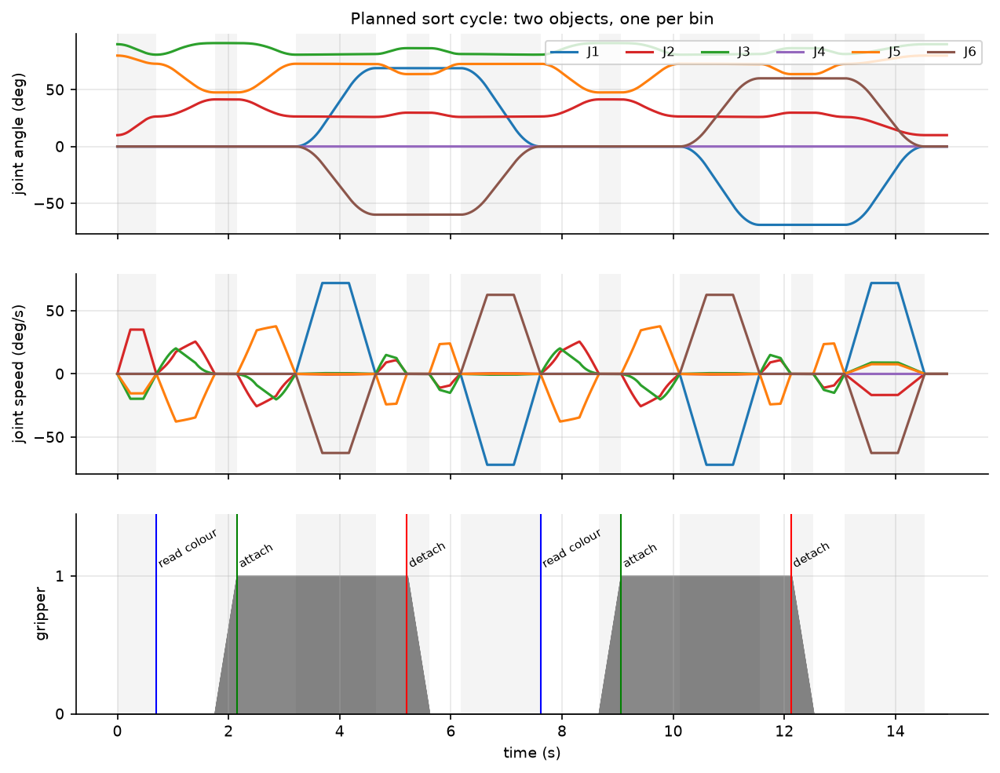
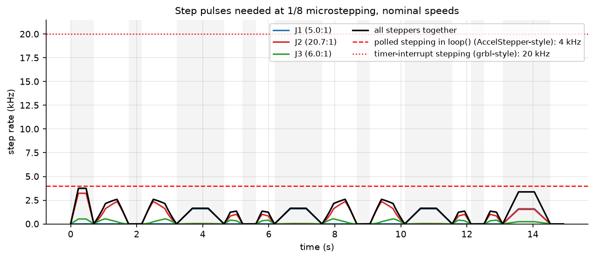
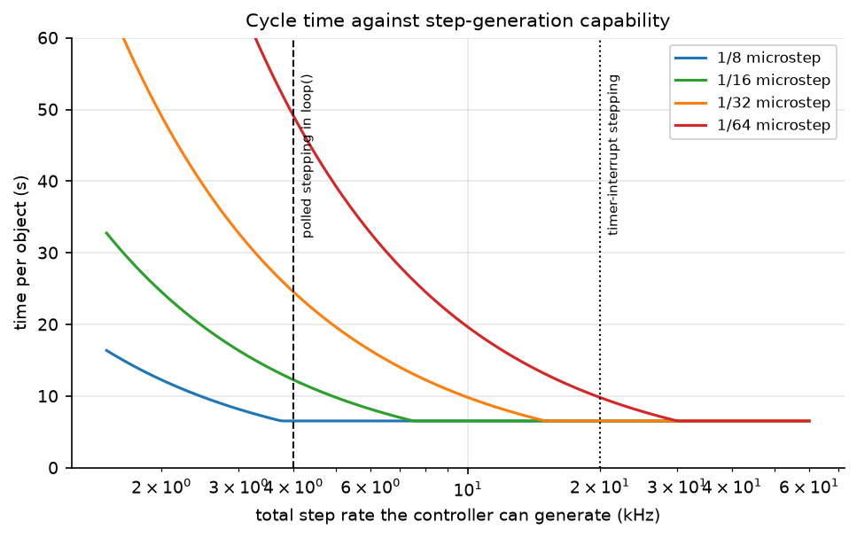

# E3 - Motion profile, step rates and cycle time

**Script:** `experiments/e3_motion_timing.py` · **Model:** `arm/task.py`, `arm/params.py`

> **Status of the inputs.** Link lengths, part masses and the cell layout are placeholders from `arm/params.py`, set before the CAD existed. Motor data other than the spec-book figures are typical catalogue values. The method and the scripts are final; the numbers must be regenerated (`uv run python -m experiments.run_all`) once the CAD values are entered.

## Purpose

Fix the speed limits, the microstep setting and the way the Arduino UNO generates step pulses.
Three steppers behind 5:1, 20.7:1 and 6:1 reductions
need many pulses per degree, and the UNO is a slow controller, so this is a real constraint on cycle time.

## Method

* This experiment times the sort cycle only (the all-axes check of E4 is left out). The sort cycle is planned by `arm/task.py`: joint-space moves between stations and straight
  vertical lines for the approach and the retreat, all with trapezoidal speed profiles
  (one third accelerating, one third cruising, one third braking).
* Step rate of an axis = joint speed x 200 x microstep x reduction / 360 deg.
* Two step-generation methods are compared, with these total budgets (assumed, to be measured on
  the first day of the build phase):
  * polled stepping in loop() (AccelStepper-style): 4,000 steps/s
  * timer-interrupt stepping (grbl-style): 20,000 steps/s
* If the nominal cycle needs more than the budget, every move is stretched in time by the same factor.
  This rule was confirmed by re-planning one slowed case: PASS.

Planned limits:

| Joint | Speed limit (deg/s) | Acceleration limit (deg/s^2) | Steps per degree at 1/8 |
|---|---|---|---|
| J1 base yaw | 90 | 150 | 22.2 |
| J2 shoulder | 45 | 150 | 92.1 |
| J3 elbow | 90 | 150 | 26.7 |
| J4 forearm roll | 200 | 300 | servo (PWM) |
| J5 wrist pitch | 200 | 300 | servo (PWM) |
| J6 tool roll | 200 | 300 | servo (PWM) |

## Result 1 - the nominal cycle

Two objects sorted in **14.9 s**: **6.5 s per object**, or 9.2 objects per minute, if the
controller can deliver the pulses.

| Segment | Start (s) | Duration (s) |
|---|---|---|
| 1: to above pick | 0.00 | 0.70 |
| 1: descend | 0.70 | 1.05 |
| 1: grip | 1.75 | 0.40 |
| 1: lift | 2.16 | 1.05 |
| 1: to red bin | 3.21 | 1.44 |
| 1: lower | 4.65 | 0.56 |
| 1: release | 5.21 | 0.40 |
| 1: retreat | 5.61 | 0.56 |
| 2: to above pick | 6.17 | 1.44 |
| 2: descend | 7.61 | 1.05 |
| 2: grip | 8.67 | 0.40 |
| 2: lift | 9.07 | 1.05 |
| 2: to blue bin | 10.12 | 1.44 |
| 2: lower | 11.56 | 0.56 |
| 2: release | 12.12 | 0.40 |
| 2: retreat | 12.52 | 0.56 |
| return to ready | 13.09 | 1.44 |
| settle | 14.53 | 0.40 |

## Result 2 - step rate and what it means for the firmware

Peak demand at nominal speed and 1/8 microstepping: **3.8 kHz** with the steppers moving together.
The one-off all-axes check (each joint alone, see E4) peaks at 4.1 kHz.

| Microstep | Peak step rate (kHz) | Time per object, polled stepping in loop() (s) | Objects per minute | Time per object, timer-interrupt stepping (s) | Objects per minute |
|---|---|---|---|---|---|
| 1/8 | 3.8 | 6.5 | 9.2 | 6.5 | 9.2 |
| 1/16 | 7.5 | 12.3 | 4.9 | 6.5 | 9.2 |
| 1/32 | 15.0 | 24.6 | 2.4 | 6.5 | 9.2 |
| 1/64 | 30.0 | 49.1 | 1.2 | 9.8 | 6.1 |

Highest speed each axis could reach if it moved alone (deg/s, polled / timer-interrupt):

| Joint | Planned limit (deg/s) | 1/8 | 1/16 | 1/32 | 1/64 |
|---|---|---|---|---|---|
| J1 base yaw | 90 | 180 / 900 | 90 / 450 | 45 / 225 | 22 / 112 |
| J2 shoulder | 45 | 43 / 217 | 22 / 109 | 11 / 54 | 5 / 27 |
| J3 elbow | 90 | 150 / 750 | 75 / 375 | 38 / 188 | 19 / 94 |

## Result 3 - the motors stay in their flat-torque range

Stepper torque is roughly constant up to a corner speed set by supply voltage and winding
inductance, `V / (2 L I steps_per_rev)`, then falls. With 24 V the corner is far above what the cycle uses.

| Joint | Peak joint speed (deg/s) | Peak motor speed (rpm) | Corner speed (rpm) | Used | Verdict |
|---|---|---|---|---|---|
| J1 base yaw | 72 | 60 | 756 | 8% | PASS |
| J2 shoulder | 35 | 121 | 756 | 16% | PASS |
| J3 elbow | 20 | 20 | 756 | 3% | PASS |

## What this decides

1. **1/8 microstepping on every stepper.** It is the coarsest setting the TMC2209 offers through its
   MS pins, and the driver interpolates to 256 microsteps internally, so finer settings add pulse load
   without a visible gain. Resolution at 1/8 is already below the servo errors (see E1).
2. **Polled stepping is enough on paper, with little headroom.** The nominal cycle needs 3.8 kHz, which is 94% of the assumed polled budget. I2C calls to the servo driver and the colour sensor share the same loop and will eat into it. Plan: start with polled stepping because it is the simplest, and move step generation into a hardware timer interrupt if the bench test shows late or missed pulses.
3. **Speed limits** of 90 / 45 / 90 deg/s on base / shoulder / elbow
   are kept for the dynamic simulation (E4).

## Limits of this experiment

* The two step-rate budgets are assumptions about the UNO, not measurements. I2C traffic to the
  PCA9685 and the colour sensor will take time from a polled loop; a bench test with the real
  firmware is the first task of the build phase.
* Whether the motors can actually deliver the planned accelerations is a torque question, answered in E4.
* The cycle has no waiting time for the colour reading or for an operator placing the next object.

---
*Generated 2026-11-12 by the script named in the header.*
