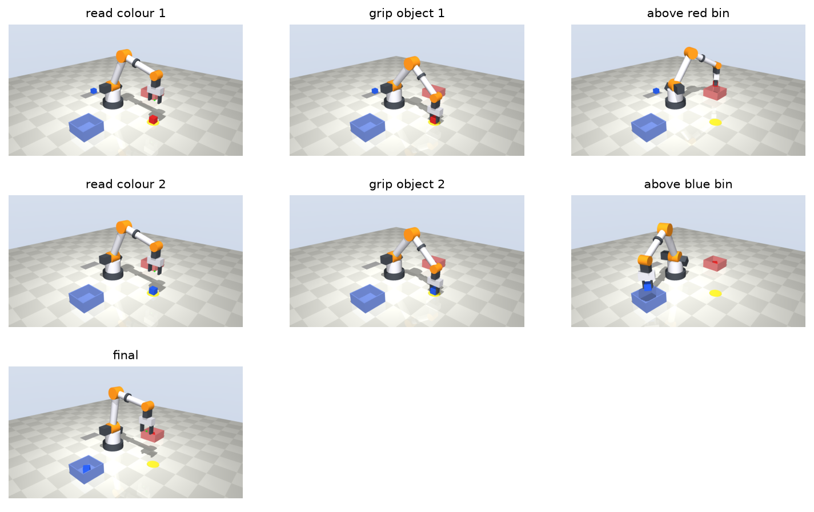
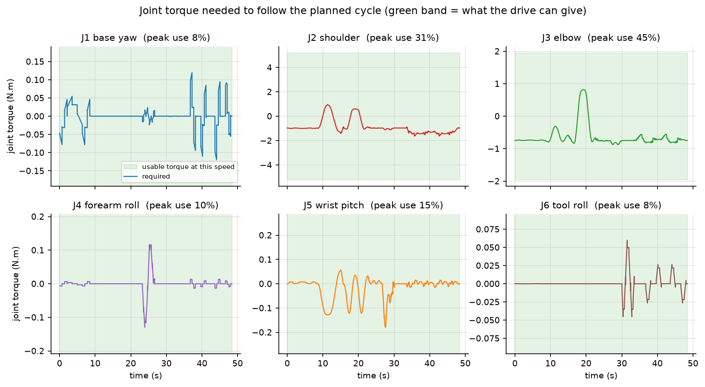
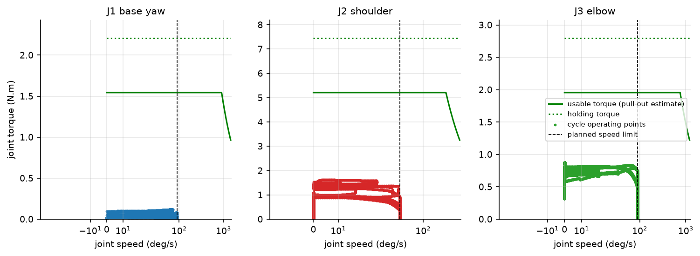
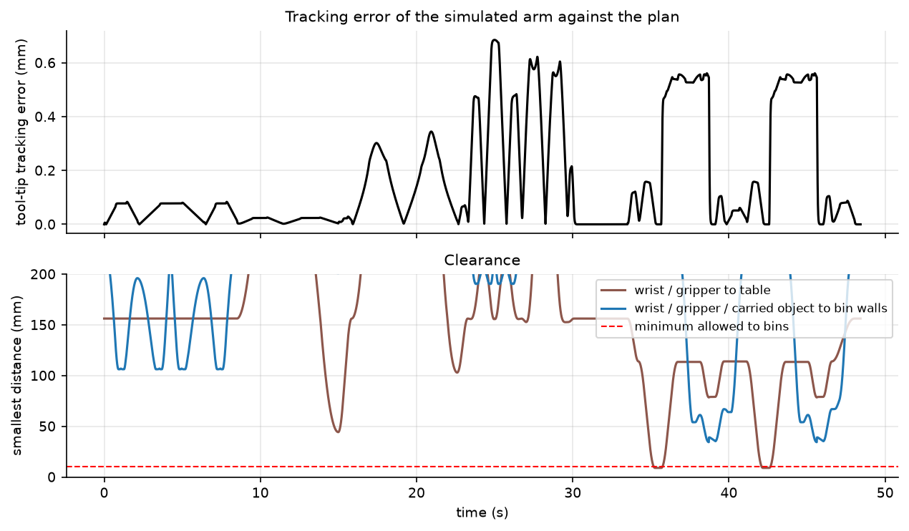
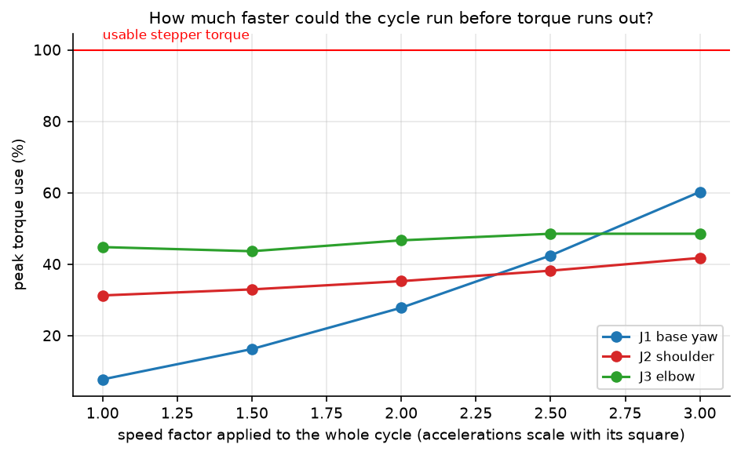

# E4 - Dynamic simulation of the pick-and-sort cycle

**Script:** `experiments/e4_pick_place_sim.py` · **Model:** `arm/mjcf.py`, `arm/sim.py`, `arm/task.py`

> **Status of the inputs.** Link lengths, part masses and the cell layout are placeholders from `arm/params.py`, set before the CAD existed. Motor data other than the spec-book figures are typical catalogue values. The method and the scripts are final; the numbers must be regenerated (`uv run python -m experiments.run_all`) once the CAD values are entered.

## Purpose

Run the complete minimum demonstration in a physics simulator before anything is built: pick two
objects at the fixed location and sort them into two bins. The run gives the torque each drive must
deliver while moving, which the static study (E2) cannot, and checks clearance to the cell.

## Video

Full-resolution clip: [`media/e4_pick_place.mp4`](media/e4_pick_place.mp4) (49 s, real time).

## Method

* **Model.** MuJoCo 4.0.1, generated from `arm/params.py`: six hinge joints with the mass budget of
  E2, rotor inertia reflected through each reduction, a two-finger gripper, the table, two bins
  and two 30 mm, 50 g cubes. Time step 1 ms. Links are drawn as simple shapes;
  the CAD meshes can replace them later without changing the results much, since mass and geometry come from the same file.
* **Motion.** The trajectory from `arm/task.py`: the all-axes check, then the sort cycle (48.4 s in total). Heavier-payload and speed studies replay the sort cycle only.
* **Control.** Each joint is driven by the torque needed to follow the plan (computed-torque
  tracking), limited to the holding torque of its drive. The logged torque is what the real
  motor has to produce: gravity, inertia, and the payload once it is gripped.
* **Usable torque.** For steppers, 70% of holding torque up to the corner speed, falling as 1/speed
  above it. For servos, a straight line from stall torque to no-load speed.
* **Grasp.** Not simulated as friction. When the fingers close, the object is attached to the hand
  if the tool tip is within 8 mm of its centre; it is released when the fingers open.
* **Colour.** The colour is known to the simulation; the sensor itself is not modelled.

## Result 1 - all six axes move

The spec book asks for "full movement in all axes and rotations". The run starts with an **all-axes check**: each joint
alone is taken towards both of its limits (to 75% of the range, less where the tool would drop below
60 mm above the table) and back. The sort cycle that follows turns the wrist by 60 deg at each bin.

| Joint | Angle reached (deg) | Travel (deg) | Joint range (deg) | Share of range | Moves at least half its range |
|---|---|---|---|---|---|
| J1 base yaw | -128 to 128 | 255 | 340 | 75% | PASS |
| J2 shoulder | -75 to 41 | 116 | 200 | 58% | PASS |
| J3 elbow | -105 to 105 | 210 | 280 | 75% | PASS |
| J4 forearm roll | -68 to 68 | 135 | 180 | 75% | PASS |
| J5 wrist pitch | -67 to 80 | 147 | 180 | 82% | PASS |
| J6 tool roll | -68 to 68 | 135 | 180 | 75% | PASS |

Verdict: PASS

## Result 2 - the sort cycle works

| Object | Tool-tip error at grip (mm) | Final position x / y / z (mm) | Bin centre x / y (mm) | In the right bin |
|---|---|---|---|---|
| object 1 (red) | 0.11 | 100 / 260 / 19 | 100 / 260 | PASS |
| object 2 (blue) | 0.11 | 100 / -260 / 19 | 100 / -260 | PASS |

Verdict: PASS

## Result 3 - torque while moving

| Joint | Peak torque in the cycle (N.m) | Largest static torque along the path (N.m) | Holding torque of the drive (N.m) | Usable torque at the critical instant (N.m) | Peak use | Peak use with a 200 g payload | Verdict |
|---|---|---|---|---|---|---|---|
| J1 base yaw | 0.120 | 0.000 | 2.21 | 1.54 | 8% | 10% | PASS |
| J2 shoulder | 1.628 | 1.541 | 7.44 | 5.21 | 31% | 40% | PASS |
| J3 elbow | 0.876 | 1.032 | 2.79 | 1.96 | 45% | 56% | PASS |
| J4 forearm roll | 0.130 | 0.166 | 1.96 | 1.22 | 10% | 1% | PASS |
| J5 wrist pitch | 0.180 | 0.187 | 1.96 | 1.18 | 15% | 2% | PASS |
| J6 tool roll | 0.060 | 0.000 | 1.27 | 0.76 | 8% | 3% | PASS |

"Peak use" is the largest ratio of required torque to usable torque at the same instant.
The dynamic peaks are close to the static values: at these speeds the arm is
gravity-dominated, so the static sizing of E2 is the governing calculation.

Verdict: PASS (no joint reached its torque limit: true)

## Result 4 - tracking and clearance

| Quantity | Value | Requirement | Verdict |
|---|---|---|---|
| Worst tool-tip tracking error | 0.69 mm | below the grip tolerance | PASS |
| Smallest distance, wrist / gripper / carried object to bin walls | 34 mm | >= 10 mm | PASS |
| Smallest distance, wrist / gripper to table (fingertips at the grip) | 9 mm | >= 5 mm | PASS |

The tracking error here is the controller's, with ideal actuators. It shows the plan is smooth
enough to follow; it is not a prediction of the real arm's accuracy (see E1 for that).

Verdict: PASS

## Result 5 - margin

Heavier payload: with 200 g instead of 50 g the peak use rises to
56% and both objects are still placed correctly.

Faster cycle: the sort cycle (without the all-axes check) is replayed at higher speed.

| Speed | Cycle (s) | J1 peak use | J2 peak use | J3 peak use | Tool-tip error (mm) | Both placed | Torque limit hit |
|---|---|---|---|---|---|---|---|
| 1x | 48.4 | 8% | 31% | 45% | 0.69 | yes | no |
| 1.5x | 10.0 | 16% | 33% | 44% | 0.59 | yes | no |
| 2x | 7.5 | 28% | 35% | 47% | 0.62 | yes | no |
| 2.5x | 6.1 | 42% | 38% | 49% | 0.68 | yes | no |
| 3x | 5.3 | 60% | 42% | 49% | 0.82 | yes | no |

Torque is not what limits the cycle time; the step-pulse rate of the controller is (E3).

## Mechanical power

Peak mechanical power at the joints: 1.17 W. Energy over the cycle: 6.5 J.
The mechanical work is tiny compared with the electrical power the steppers draw to hold
position, so the power budget (E5) is set by holding currents, not by motion.

## What this decides

1. The minimum demonstration is feasible with the provided actuators and the reductions chosen in E2.
2. The most loaded joint is the elbow at 45% of its usable torque; the design keeps
   working with a payload four times heavier (56%).
3. The cell layout (pick spot and bins) is clear of collisions with 34 mm to spare at the bins.
4. The planned speed and acceleration limits can go into the firmware as starting values.

## Limits of this experiment

* Ideal actuators: no lost steps, no backlash, no belt stretch, no servo dead-band, no friction model.
* The grasp is an attachment, so finger force and slip are not tested.
* Homing on the limit switches and the colour decision are firmware logic and are not in this run.
* Link shapes are placeholders, so clearance near the arm's own structure is approximate. Self-collision of the arm with itself is not checked, which matters most at the extremes of the all-axes check.

---
*Generated 2026-11-12 by the script named in the header.*
