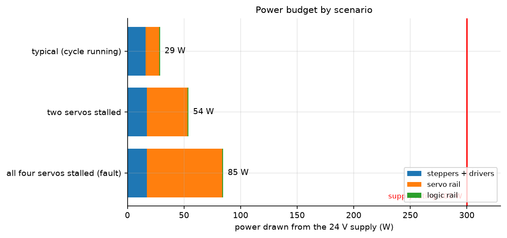

# E5 - Power budget

**Script:** `experiments/e5_power_budget.py` · **Inputs:** `arm/params.py`, peak mechanical power from E4

> **Status of the inputs.** Link lengths, part masses and the cell layout are placeholders from `arm/params.py`, set before the CAD existed. Motor data other than the spec-book figures are typical catalogue values. The method and the scripts are final; the numbers must be regenerated (`uv run python -m experiments.run_all`) once the CAD values are entered.

> Servo currents, converter efficiencies and logic currents below are typical values, not datasheet
> figures for the delivered parts. Replace them in the script header when the datasheets are available.

## Purpose

Check that the provided 24 V 12.5 A supply and the two buck converters can feed the arm, and
propose which converter feeds which rail. The arm is mains-powered, so there is no battery-life question.

## Rail plan

| Rail | Source | Loads |
|---|---|---|
| 24 V | power supply, through the emergency stop and the fuse | 3 x TMC2209 on the CNC shield (stepper power) |
| 6 V | XL4016 buck converter | 4 servos through the PCA9685 V+ terminal |
| 5 V | LM2596S buck converter | Arduino UNO, PCA9685 logic, colour sensor, proximity sensor, driver logic |

Keeping servo power and logic power on separate converters stops servo current spikes from resetting the Arduino.

## Method

* **Steppers.** A chopper driver holds the winding current at its set value whether the motor moves
  or not, so each stepper draws about `I^2 R` in copper loss (4.3 W at 1.7 A,
  1.5 ohm) plus about 1 W in the driver, all the time. Peak mechanical power from
  the dynamic simulation is 1.17 W in total, which is negligible beside that.
* **Servos.** Typical: two servos moving at 0.7 A and two holding at 0.2 A. Worst: stalled
  at 2.5 A each.
* **Logic.** Arduino UNO 50 mA, PCA9685 logic 10 mA, TCS34725 + LED 25 mA, E18-D80NK proximity sensor 25 mA, 3 x TMC2209 logic 30 mA.
* Converter efficiencies: 90% (XL4016), 85% (LM2596S).

## Results

| Scenario | Steppers (W) | Servo rail (W) | Logic rail (W) | Total (W) | 24 V current (A) | Share of supply | Below 80 % of supply |
|---|---|---|---|---|---|---|---|
| typical (cycle running) | 16 | 12 | 0.8 | 29 | 1.2 | 10% | PASS |
| two servos stalled | 17 | 36 | 0.8 | 54 | 2.2 | 18% | PASS |
| all four servos stalled (fault) | 17 | 67 | 0.8 | 85 | 3.5 | 28% | PASS |

| Check | Demand | Capacity | Verdict |
|---|---|---|---|
| Servo rail, typical | 1.8 A | 8 A (XL4016) | PASS |
| Servo rail, two servos stalled | 5.4 A | 8 A (XL4016) | PASS |
| Servo rail, all four stalled | 10.0 A | 8 A (XL4016) | **FAIL** |
| Logic rail | 140 mA | 2 A (LM2596S) | PASS |
| 24 V input, worst case | 3.5 A | 20 A fuse, 12.5 A supply | PASS |

## What this decides

1. The 300 W supply is far larger than needed: about 29 W in normal running and
   85 W in the worst fault case.
2. The XL4016 covers normal servo use with a wide margin. All four servos stalled together would exceed its rating; that is a fault, not an operating case, and the firmware should stop the cycle if the gripper or wrist is blocked.
3. The 20 A fuse protects the wiring but will not blow on a servo fault. A smaller fuse on the 24 V input
   (5 A) would protect better and is worth requesting.
4. The steppers hold full current all the time, about 16 W of continuous heat in three motors.
   Lower the driver current on the base axis, which carries no gravity load, and check motor temperature in the build phase.

## Limits of this experiment

* A budget from typical values, not a measurement.
* Inrush and servo start-up spikes are not modelled; a 1000 uF capacitor across the servo rail is the usual precaution.

---
*Generated 2026-11-12 by the script named in the header.*
